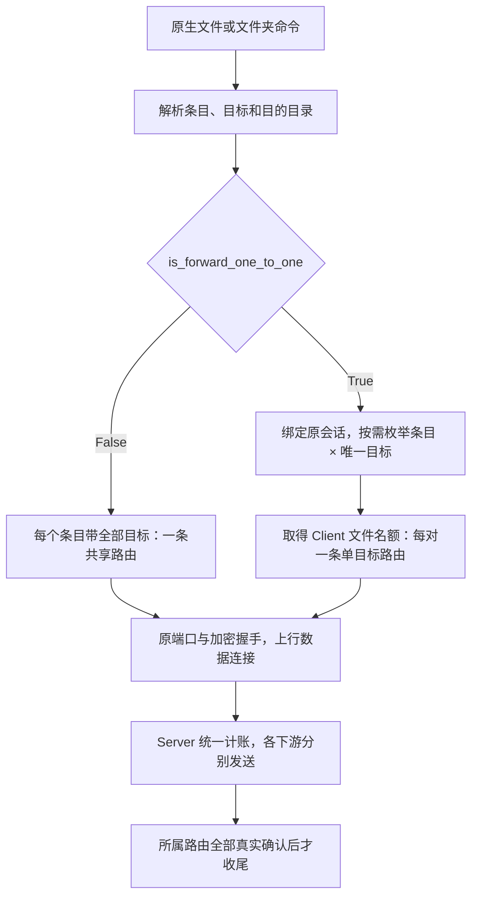

# connect_tcp 原生一对一转发 — 更改计划

状态：**A1–A3 已审计放行，A4 已完成计划内的本机总验收，待人工最终确认**。依据：[需求卡与 P1–P8](forward-one-to-one-requirements.md)、[文件转发词汇表](../../GLOSSARY.md)。[总体报告](forward-one-to-one-report.md#a4总体报告与最终验收)记录实际结果、存量风险及未覆盖项。

## 1. 决策与接口

- 在 `TCP_Client_Base.__init__` 的 `is_auto_reconnect` **之后**追加 `is_forward_one_to_one=False`，保留所有旧位置参数。只在原生文件/文件夹发送端选择首次转发的组织方式；接收端不需要启用它。`flow_setup` 只补 Client 的默认配置，原 `TCP_Client_Base(**config)` 透传入口不变，不新增 CLI 命令或 Web 开关。
- `False`：一个文件条目一次上传，一条路由覆盖全部已接受目标，用户暂停、继续与最终确认仍以整个转发任务为单位。`True`：一个文件条目 × 一个目标是一个独立任务，复用现有单目标发送。多个文件不会与目标按位置配对，也没有“这一批文件全部完成才能发下一批”的屏障。
- Server 不辨识配置，也无须识别哪些请求来自同一条用户命令。继续按每条 `/forward_item` 自带的目标集合创建路由。无新 wire 字段、握手、ACK、进度格式、父任务或模式迁移。同一文件发两份会产生两次独立上行读/传，**不是**在上行数据连接内复用一次文件内容。
- **唯一跨模式的资源变化**：更新后的 Server 对所有原生转发共用一份严格的 `max_mem_buff` 字节预算。旧 Client 的两个同时运行的转发也会争这份额度。协议格式保持不等于旧 Server 会凭空获得总额保证：依赖该保证的部署应更新 Server。Client 上已有的同名参数不作中转服务的配置来源。

## 2. 现状、入口和拟改数据流

依据为当前 `PyFlow/network_api/connect_tcp.py`：Client 构造器 8164–8187、文件信号量 8340–8341、命令解析/driver 11511–11609、单条握手与发送 11631–11725；Server 目标筛选 7253–7307、去重/路由准入 7413–7463、pump 7679–7843。Web 的 `client_backend.py:454–468` 已调用同一原生入口。普通 `/multiple_file` 是每文件一个等待线程，取得信号量后才读当前 socket（11029–11075）；**复用其名额，不复制其等待线程模型**。



### 2.1 发送端：先限流，再开连接

1. 不重拼或重新切割用户命令文本。在结构化参数层保留含空格路径、`kind`、`rel_dir`、文件名、目的目录；沿用当前目录遍历（不增加空目录交付）。新模式先按原有端点规则规范化地址、过滤自身、保持首次出现顺序去除重复目标。自身过滤复用 `_forward_one` 的规则，不造第二套 DNS/端口别名逻辑。目标是否在线仍由 Server 校验；单项拒绝或异常不结束其他项的枚举。
2. 在一条命令内按目标和**请求能确定的目的路径**判冲突：普通文件用 destination 下的文件名，目录条目再计入相对目录。先列入调度的保留，后来的跳过并提示，早于 FID/握手；不能用源绝对路径或只用 basename 来判目录冲突。同一命令目标列表相同，可对条目落点先去冲突再与目标相乘，不需存储整个乘积。不改接收端既有的文件覆盖策略。
3. 沿用后台 driver，按需产生下一项；在有界的发送准入处复用 `file_semaphore`，**取到名额才启动单目标发送**，不为全部组合创建线程、Future、端口或进度行。已获准任务不在循环内逐个 `join`。所有命令共享该实例现有名额，单目标也不绕过。等待时能感知原会话关闭；获准后、发请求前再校验实际 socket，显式传给 `_forward_one`。正常、异常、线程未能启动、取消均有唯一的名额归还者；不在持全局锁时等待名额、网络或最终 ACK。
4. 暂停中的任务保留原数据连接和名额。`max_thread_num=1` 时没有空位的 C 自然要等；这不代表 C 收到了 B 的用户暂停。关闭/替换控制会话取消未发起项并提示，不用新连接继续旧队列；受 `max_thread_num` 限制的是发送名额，不是整个进程的线程总数。
5. 新任务用 `_forward_one` 原有分配器分配新 upstream FID，跟踪开启时在握手前预绑定 `(server_peer, fid)` 和逻辑目标；Server 仍分配 child FID。同路径不同目标有独立键。响应照旧按实际控制 socket + FID 匹配；显式错误、结果未决、保留进度与最终 ACK 按现有规则处理。不因字节走到 EOF 就报成功，不增加重试或批量失败回滚。
6. 恢复走 `_resume_on_socket` → 原单目标重放，以旧 FID、旧路由、实际 offset、接收端保留路径为准；**不经首次枚举、冲突跳过或新 FID 分配**。开启模式的 Client 让实际开始的转发重放也遵守同一份发送名额，只取一次；利用现有按 owner 合并/收尾机制，不阻塞控制 reader、不让忙于等待旧 owner 的请求占死名额。切换开关不得拆已存的一对多 route 或合并已存的单目标 route。跟踪关闭不新建持久行；已有记录和运行时控制仍遵守原契约。

### 2.2 Server：只共享额度，不共享文件

现在每次 `_forward_pump` 独立建立 `relay["buffer"]`，按 `len(chunk) × 活跃队列数` 记账，入队后才检查高水位；writer 的当前项在 `send_message` 返回后才还账，异常还要清空自己的队列。拆分后若不改此处，配置值不变但多个 pump 可以分别积压到该值。

- 在 **Server 实例**内维护唯一总账和等待/唤醒条件；每个 pump 保留自己的队列、目标和控制状态。对每份下游待交付字节，先预留额度再发布；已预留/已排队/已取出但 writer 发送尚未返回的同一份字节只计一次。正值配置下任何时刻都有 `0 <= 已计费总量 <= max_mem_buff`（以字节计）；沿用现有 MiB 入参及最小有效字节约定，不预分配一大块内存。
- 计费包含转发的元信息和正文；共享上行的同一分块按实际接收队列份数计费，即使各队列引用同一 bytes。分块大于额度时按可容纳的段发送；若一次扇出的份额比总预算还大，按目标分批预留/入队，不等待一个永远不可能满足的整组请求。每条下游看到的字节顺序和内容不变。零正文仍走正确的头和确认；没有下游的终态补确认不虚占队列额度。
- 容量耗尽时让后台 reader 等，writer、控制 reader 和 asyncio loop 仍可继续。不得持预算锁做网络 I/O 或等待 route 锁；不要在等一个空闲/暂停上游送下一块时替它预占整份额度。writer 成功或失败归还当前项，清空未发队列、目标退出、发布失败或停服也须退还所属余额并唤醒等待者。等待期间若目标/会话退出，重新核对归属，不能入已销毁队列或重复归还。
- 足够额度释放后其他任务可继续，不必等占用者的整文件完成。资源等待**不发送** `/pause_trans` 或 `/start_trans`，用户 start 不释放额度。此上限不是 RSS：读头/读块临时对象、线程、系统 socket、加密层等不在上述队列计费内；不承诺最低带宽、严格公平或运行中缩小配置的即时效果。

## 3. 文件范围

| 类型 | 路径 | 意图 |
|---|---|---|
| 修改生产代码 | `PyFlow/network_api/connect_tcp.py` | Client 构造、原生命令/driver、单目标发送/恢复准入和会话收尾；Server 实例预算、`_forward_pump` 与释放/唤醒。不复制 relay 协议状态机。 |
| 修改 Client 配置 | `PyFlow/flow_setup.py` | `CLIENT_DEFAULTS` 暴露同名布尔值；不改 `SERVER_DEFAULTS` 或用户已有 `setup.json`。 |
| 修改契约测试 | `test/unit/test_flow_setup.py`、`test/unit/network_api/test_TCP_client.py`、`test/unit/network_api/test_transfer_control.py` | Client 配置透传、输入/准入与预算边界；复用现有 fixture，新增断言针对可见行为。 |
| 修改真实网络测试 | `test/integration/network_api/test_tcp_file_transfer.py`、`test/integration/network_api/test_tcp_transfer_control.py`、`test/integration/network_api/test_tcp_transfer_resume.py` | 多目标/目录、全局预算、用户控制隔离、失败及重连；保留原共享路由回归。 |
| 修改使用说明 | `docs/source/File_Transfer/File_Transfer.rst`、`docs/source/Network_APIs/TCP_Client_APIs.rst`、`docs/source/Network_APIs/TCP_Server_APIs.rst`、`docs/source/Instance_Setup/Instance_Setup.rst` | 开关与例子、资源作用域、一对多/一对一的进度和收尾差异。 |
| 拟新增（实施时） | `docs/source/changes/forward-one-to-one.md`、`docs/plans/forward-one-to-one-report.md` | 对外变更说明；分阶段及总体验收的实际证据，未运行前不写通过报告。 |
| 本规划阶段 | `GLOSSARY.md`、`docs/plans/forward-one-to-one-requirements.md`、本计划 | 词汇、已选需求与待审方案。 |

不删除文件，不修改消息转发、`PyFlow/forward_extension_tcp.py` 落盘扩展、Web UI、CI、依赖或覆盖率策略。不新增传输结果 API、持久化待发清单或自行分配端口的旁路。

## 4. 原子拆分与审查顺序

行数为预估改动行（含测试和相关说明），不是代码配额。各阶段须局部证据和人工审查；超出可审范围就退回改计划，不顺手扩项。

| 阶段 | 单一意图、涉及范围 | 路径与局部验证 | 预估行 |
|---|---|---|---:|
| A1 | 使所有原生 pump 共用严格字节预算：Server 与现有压力用例/资源说明一起迁移。先保证多路并行不会把预算乘大。 | P5、P4 的背压分支、P8；V1、S-pressure | 180–360 |
| A2 | 交付 Client 可选按条目×目标调度：开关/配置、结构化拆分、共享准入、等待项取消与原重放入口接入；附局部文件/目录、名额和会话测试、Client 说明。 | P1–P3、P6、P7 准入；V2、S-split、S-session | 220–420 |
| A3 | 固化真实交付/恢复隔离证据：同一源路径的两个独立 FID 与默认共享 route 对照，覆盖用户控制、单项失败、断点和最终确认。主要是现有集成测试与使用/变更说明，不另造生产状态机。 | P1、P3、P4、P6、P7；V3、S-split、S-session | 140–300 |
| A4 | 逐路径汇总与总验收：回归旧模式与非目标消费者，记录平台、未覆盖项和实际输出。 | P1–P8；V4 及四个运行场景 | 50–150（报告） |

## 5. 可执行验收与证据

下列 V1–V4 已分阶段执行，实际命令与退出状态见[阶段报告](forward-one-to-one-report.md)。V4 为受影响范围合并回归，不是全仓测试或跨平台认证。

```bash
P=.venv/bin/python
U=test/unit/network_api
I=test/integration/network_api
# V1：真实慢 writer、跨 route 竞争、压力与用户意图相互独立
$P -m pytest -q "$U/test_transfer_control.py" "$I/test_tcp_file_transfer.py::test_forward_flow_control_pauses_uploader" "$I/test_tcp_file_transfer.py::test_forward_shared_budget_across_routes" "$I/test_tcp_transfer_control.py::test_relay_pressure_preserves_user_intent_and_source_start_cannot_open_reader"
# V2：配置、输入、共享名额、目录与旧模式
$P -m pytest -q test/unit/test_flow_setup.py "$U/test_TCP_client.py" "$I/test_tcp_file_transfer.py::test_forward_file_to_multiple_clients" "$I/test_tcp_file_transfer.py::test_forward_one_to_one_item_target_admission" "$I/test_tcp_file_transfer.py::test_forward_one_to_one_folder_destinations"
# V3：真实暂停、乱序握手、单路恢复及旧路由的全目标 ACK
$P -m pytest -q "$I/test_tcp_transfer_control.py::test_forward_one_to_one_pause_isolation" "$I/test_tcp_transfer_resume.py::test_forward_one_to_one_session_recovery" "$I/test_tcp_transfer_resume.py::test_concurrent_forward_upload_handshakes_match_out_of_order_replies" "$I/test_tcp_transfer_resume.py::test_forward_route_is_removed_only_after_all_real_targets_complete"
# V4：最终一次受影响范围合并回归；不改既有 CI 或测试阈值
$P -m pytest -q test/unit/test_flow_setup.py "$U" test/unit/transfer_web/test_web_transfers.py test/unit/transfer_web/test_file_location.py "$I/test_tcp_file_transfer.py" "$I/test_tcp_transfer_control.py" "$I/test_tcp_transfer_resume.py" "$I/test_crypto_tcp.py" "$I/test_tcp_async_server.py" "$I/test_tcp_broadcast_alloc.py" test/integration/test_forward_extension.py test/integration/test_forward_msg_attribution.py
```

规划时的两处压力测试**要求旧行为越界**：`test_tcp_file_transfer.py:773–804` 用“写出块大于上限”阻塞并断言超水位；`test_tcp_transfer_control.py:679–711` 也要求 `peak > high_water`（均为规划时行号）。A1 已将阻塞点改成指定下游 writer 实际尚未完成的发送；保留“确实等额度、控制状态不变、释放后继续、真实内容、ACK、资源归零”证据，并把界限加强为**全实例采样峰值不越界**。

实施时用隔离临时目录和本机真实 TCP 实例编写一次性 `/tmp/pyflow-forward-one-to-one-smoke.py`；命令 ` .venv/bin/python /tmp/pyflow-forward-one-to-one-smoke.py --case <case>`（case 取下表名称）。脚本不用 pytest 用例作入口，不 mock 掉握手、加密、文件、端口、数据或 ACK。可用同步闸门稳定安排慢写/乱序并记录计数；超时只用于判失败。实施报告记录实际命令、退出码和所跑环境，再清理临时脚本。

| case | 路径/关键断言 |
|---|---|
| `baseline`（S-baseline） | P1/P2/P8：缺省/False 一次上行、两条下游、B 用户暂停时 C 同属该任务、最终等两个真实 ACK。单目标、Web 原入口、嵌套 destination、重复/自身/同 IP 不同端口和不可达目标，逐一核对请求、内容和清理。普通、消息、扩展由 V4 对应真实调用回归。 |
| `split`（S-split） | P2/P3/P4/P7：x、y 发 B、C，同一个 x 对应不同 upstream FID 和数据 socket；B 确认暂停 x **期间**，C 的 x 和有空位的 y→B 能完成并单独收尾。C 的控制不解除 B 的暂停；B 沿原 socket 继续，最终内容逐字节相符。覆盖同名不同目录、路径冲突跳过、多条命令与普通批量共用名额。 |
| `pressure`（S-pressure） | P4/P5/P8：不同源、不同文件、共享和单目标路由同服，预算小于分块及单次扇出需要的量。扣住 writer 让总账确实满，采样预留/归还和峰值；释放、writer 失败、源断线、停服分别证明不会死等/漏还。显式 start 不能开预算闸，自动排空也不替用户 start。 |
| `session`（S-session） | P3/P6/P7/P8：阻住端口应答或 ACK，单项拒绝/断线不影响其他 FID；旧会话的待发项无 FID/持久行/新 socket，新会话仅按原记录恢复。比对 `(server_peer,fid)`、child、原路径、数值 offset、五字段快照读回、零文件与 EOF 补确认；不同流收尾不互删。 |

矩阵取真实明文/加密、线程/async Server、跟踪开/关、自动/手动端口和原端点重连（含已支持的别名/通配绑定）。保留可核对的控制/数据连接数量、FID→目标、发送名额峰值、计费峰值、暂停期间谁完成、内容一致性、真实 ACK 和最后剩余 owner/端口/队列；不记录密钥或正文。不以文件出现、进度等于大小、RSS 或历史测试数代替以上任一结论。没有实际跑过的平台/组合注明未覆盖，不推断 Windows 等同 Linux。

## 6. 本轮界限和下一闸门

风险集中在：锁顺序与配额归还、同路径不同 FID 的并发快照、突然关闭/重连时的所有权。优先复用 `_transfer_handshakes`、进度锁/原子写入、`palloc/pfree` 和现有加密读写；核对注册/删除与快照的一致性，不借此重构整套 TCP。源文件发送途中被修改、跨进程写同一进度文件、不同命令/不同发送者在接收盘上写到同一实际路径、NAT 或端点变更、同 FID 旧控制消息的代次隔离，均不作新增保证。

实施闸门：A4 的 V4 及四个独立场景已完成，结果只覆盖报告列明的环境与路径。是否接受未覆盖项、存量风险及是否合并/推送，仍由需求方最终确认；不自动提交、合并或推送。
