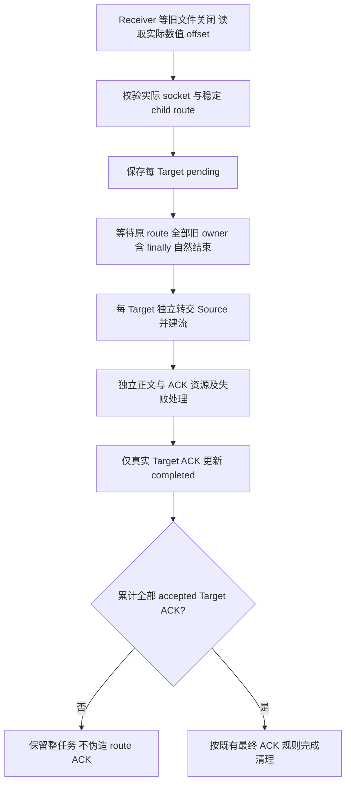

# 传输控制生命周期、全局转发暂停与独立并行恢复 — 更改计划

状态：**C5 实现、局部/完整验证与双轴审查完成：最终 pytest 994 passed、1 skipped；最终八项专项、V5 和三组 S6 程序的证据见报告**。已关闭配置 IP 与实际源 IP 不同时误拒合法目标的 P2。C1–C4 保留；C5 仅在 Client 原生转发入口拒绝自身，不改协议、进度模型或 Source 发送算法。类型检查仍有 37 条改动范围外诊断；C6 未实施，仅提交当前分支，不合并或推送。

需求依据：[需求卡](transfer-control-lifecycle-requirements.md)。历史实现依据：[上一轮计划](transfer-pause-start-direction-plan.md)及其报告；它们的历史验证结果不作为本轮验证结果。

## 1. 本轮范围与替代关系

### 1.1 本轮范围与保留/后续边界

1. **问题四/五**：按实际控制 socket 管理旧会话资源，删除按 peer 扫描进度表关闭当前 socket 的重复机制；旧 worker 不借用新控制连接。
2. **问题六**：C5 拒绝 Client 自身完整控制端点（同 IP 且同端口），混合只剔除自身，其他合法目标仍传输；已获本轮实施批准，不混 C6。
3. **问题七**：Source 是 route 的唯一用户控制仲裁者；任意端 pause/start 控制整个转发任务。暂停源端新增块，已有字节继续排空，数据 socket 不断开。
4. **问题八**：8A 的 C3 独立并行恢复已实现，查询/强制 teardown/FIFO 单轮方案已撤回。8B 的 C4 已实现复用原 fid route/completed 和 Source 共享上传行，补全目标完成后的显式 EOF 最终确认；路径与边界见 6.1，实际证据见报告。

### 1.2 明确排除

- 撤回问题一“正常恢复流程已证明导致内容损坏”的结论；不以此另开修复。
- **问题二暂缓**：不为旧 pause/start 与同一控制会话、同 fid 数据腿重建的交叉窗口增加 leg_id、换新 fid 或其他代次隔离。控制发送失败沿用现有失败/关闭路径，允许人工重新操作或结束控制会话后恢复；不承诺该窗口自动无缝收敛。问题四/五的断线清理与其余恢复方案不因此取消。
- 问题三是已确认语义，不改为各端独立持有暂停锁。
- 问题九（超长文件名）、十（控制队列增长）、十一（无 owner 预置暂停）暂不处理。
- 不增加内存/磁盘回放缓存、不同 offset 的并行范围过滤、第二结果通道、ACK-of-ACK、能力协商或旧 wire 兼容分支。
- 不重构整个 TCP/加密/日志系统，不改 CI、依赖和覆盖率策略，不扩展 Web UI。
- 不承诺 NAT、控制端点变化后的身份迁移、跨进程同时写进度文件、同尺寸源文件内容变化或断电耐久性。

### 1.3 对旧契约的明确替代

- **保留**恢复时稳定 upstream fid/child fid、原接收路径、pause/start 及端口响应格式；不实现 leg_id、old/new fid 关联、恢复身份 rekey 或持久化迁移记录。
- **废弃**“Target 只暂停自己的 writer”；替换为 Source 仲裁全 route 停止新增源数据。
- **替换转发恢复**的 live upstream busy 静默跳过及旧 C3 强制重建：合法请求仅入队，等原 route 全部旧 owner（含 finally）自然收尾；随后每 Target 独立 Source→Server→Target 恢复，不将一个恢复流的正文/ACK 变成另一个 Target 的 barrier。
- **普通传输**的 live/paused/negotiating/finalizing busy 静默跳过仍保留；暂停用 start，不因此扩大成任意普通传输强制重启。
- 用户 API 的 bool 仍表示登记/预留，不表示远端确认、恢复完成或文件成功。

## 2. 变更文件清单

| 类型 | 文件 | 关键内容 |
|---|---|---|
| 修改生产代码 | `PyFlow/network_api/connect_tcp.py` | 实际会话资源、固定 worker 控制 socket、relay 全局控制/恢复调度、自目标校验及完成清理；不改端口/控制帧字段 |
| 修改单测 | `test/unit/network_api/test_resume_matching.py` | 保留普通恢复 busy、稳定 fid/原路径/总长/offset 及收尾；覆盖恢复入口与会话生命周期交叉 |
| 修改单测 | `test/unit/network_api/test_transfer_handshakes.py` | 实际会话取消、listener/data owner 退役及旧 owner 排空；不增加代次字段 |
| 修改单测 | `test/unit/network_api/test_transfer_control.py` | Source 仲裁、全局状态转发、交叉意图和背压独立；不新增跨腿旧控制隔离保证 |
| 修改单测 | `test/unit/network_api/test_fid_routes.py` | 稳定 route/child、原 owner 全收尾、pending/active 每 Target 隔离、真实 completed、错误实际会话无副作用 |
| 修改单测 | `test/unit/network_api/test_transfer_progress_query.py`、`test_delete_config.py` | 保持既有查询/快照 schema，关闭/删除与恢复占用 |
| 修改单测 | `test/unit/network_api/test_TCP_client.py`、`test_TCP_server.py` | 控制会话替换及资源生命周期必要回归 |
| 修改集成测试 | `test/integration/network_api/test_tcp_transfer_control.py` | 普通双端控制回归、全局暂停、旧会话清理及多恢复 owner 的共享控制 |
| 修改集成测试 | `test/integration/network_api/test_tcp_transfer_resume.py` | 普通/转发同 fid、新旧 owner 边界、不同 offset 并行恢复、晚来目标、单流失败、真实 ACK、重连与持久化 |
| 迁移受影响断言 | `test/integration/network_api/test_tcp_file_transfer.py`、`test_crypto_tcp.py`、`test_tcp_async_server.py`、`test/integration/test_forward_extension.py`、`test_forward_msg_attribution.py` | 保留既有恢复/全局暂停消费者；C5 自目标回归另见第 2.2 节，不做端口或控制协议迁移 |
| 修改使用文档 | `docs/source/File_Transfer/File_Transfer.rst`、`docs/source/Network_APIs/TCP_Server_APIs.rst`、`TCP_Client_APIs.rst` | 数值 offset、原 route 收尾、独立流、全局暂停及暂缓边界 |
| 修改变更记录 | `docs/source/changes/transfer-fid-routes.md` | 保留稳定恢复 fid，取代独立 writer 暂停及 busy 恢复等旧契约；明确问题二暂缓 |
| 计划载体 | 本文件、`transfer-control-lifecycle-requirements.md` | 已批准的新方案与旧 C3 撤回边界 |
| 更新既有报告 | `docs/plans/transfer-control-lifecycle-report.md` | 保留旧证据；本轮独立列路径、失败、风险和待验证项，不编造通过 |

Web 的 `client_backend.py` 已知通过 Client 的文件/文件夹转发入口调用，不直接构造恢复消息；计划不修改该文件，统一入口必须覆盖 Web 调用。若实施发现额外真实消费者须修改，先更新文件清单，不扩大成 UI 功能。

当前 LSP 只有 Ruff，不支持 definition/references；本轮按现有声明和文本调用点定位。实施前重新检查导航能力；支持 references 时，改公开符号前必须查询引用，不声称 Ruff 已完成引用分析。

### 2.1 本次 C4 限定文件（已获实施批准）

上表为整个生命周期任务的总清单，不代表 C4 可以顺带修改所有文件。本次仅限下列文件，不新增生产模块或测试文件，不删除文件：

| 文件 | C4 修改点 |
|---|---|
| `PyFlow/network_api/connect_tcp.py` | Server `_forward_item_handler` 的终态准入、`_forward_relay` 的仅上游建流、`_forward_pump` 的 EOF/最终 ACK 分支；复用资源 registry、握手和 `_drop_fid_route`，不另写发送协议 |
| `test/unit/network_api/test_fid_routes.py` | 既有完成集合、原目标成员、实际 Source 会话、原 route 对象、重载与同任务 owner 排他契约 |
| `test/integration/network_api/test_tcp_transfer_resume.py` | 扩展既有 `test_forward_ack_write_failure_retains_source_and_completed_route` 等真实 ACK 测试；补重复失败、显式成功、Target 离线、零正文、错误请求及 finally 交叉 |
| `test/integration/network_api/test_tcp_file_transfer.py` | 用户在完整测试出现唯一旧契约失败后明确批准：仅迁移背压测试，从旧自动 pause/start 消息计数改为本地 reader 阻塞/释放、完整内容和真实 ACK；不改生产背压 |
| `docs/source/File_Transfer/File_Transfer.rst` | 记录所属端、EOF 与交付完成的区别、显式触发和清理时点 |
| `docs/source/Network_APIs/TCP_Server_APIs.rst`、`TCP_Client_APIs.rst` | C4 支持范围、`resume_trans` 登记语义、Target 离线及失败保留边界 |
| `docs/source/changes/transfer-fid-routes.md` | 本次行为变化及保留契约 |
| `docs/plans/transfer-control-lifecycle-requirements.md`、本计划、`transfer-control-lifecycle-report.md` | 需求/计划状态、逐路径实际证据、风险与人工审查；历史结果不覆盖 C4 |

`GLOSSARY.md` 已在本轮澄清领域术语，不定义新的实现记录；C4 实施不以此为新增表的依据。`test_resume_matching.py`、`test_transfer_control.py`、`test_transfer_handshakes.py` 仅作为既有契约回归，不计划修改。若必须扩大文件或 Source 发送实现范围，先修订计划并获批准，不在实现中顺手扩展。

完整 pytest 实际为 984 passed、1 failed、1 skipped；唯一失败仍要求旧自动背压控制帧。用户已选择 `migrate_contract`，批准上述单函数迁移及窄重验，不再次运行全套。C4 审查另定位到旧恢复 tuple owner 在 route 已删除后的 finally 窗口：不同 Target 的新 route 复用同值 fid 时，不应被该旧 Target owner 误判 busy；修正限于既定 C4 准入及同文件真实恢复回归，不改 Source 或扩大生产范围。

### 2.2 本次 C5 实施清单（用户已批准开始）

- **单一意图**：原生 Client 文件/目录转发拒绝自身完整控制端点；混合目标只剔除自身，保留同 IP 不同端口及同端口不同 IP 的合法目标。自身比较使用 worker 捕获的实际控制 socket；配置主机仅在解析为实际 IP 时作为别名，wildcard 仅别名实际端口。未绑定/本地端口回退后未使用的配置 IP 不能被拼接为自身身份。
- **文件**：生产仅改 `connect_tcp.py::_forward_one`，在 fid/上传行/握手创建之前统一筛选目标；同一筛选结果用于进度 peer、线上目标及最终发送。`test_tcp_transfer_resume.py` 补 self-only/mixed/恢复的真实 socket 契约；既有 Web 与 console/driver 适配调用同一入口，Web 后端不改。使用文档限 File_Transfer、TCP_Client_APIs 和变更记录，需求/本计划/本报告同步。
- **数据流/全集**：console file、console folder（含各嵌套条目）、Web file/folder、已有行显式恢复 → 原 driver/`_forward_one` → 目标规范化/自身过滤 → 无目标则记录拒绝并返回 False，不发请求/不分配 fid/不建新进度；有合法目标则走原 port/header/body/真实 ACK。恢复公开 bool 仍表示 worker 预留，拒绝保留旧行，不伪造完成或删除既有数据。
- **验收**：窄真实消费者回归检查拒绝文本、无新增 route/child/进度/握手及恢复旧行不变；mixed 路径完整内容与 Source 实际 ACK、进度 peer 不能残留自身。S6 另用一次性真实程序验证明文/加密、thread/async、别名/wildcard、实际同机不同端口、Web 适配、恢复与资源收尾，结束删除。V5 受影响回归只运行一次；不把未运行的参数笛卡尔积或 C6 算通过。
- **提交**：一个 C5 原子变更，预计生产约 20 行、回归约 150 行及必要文档；不混 C6，不改公开签名/wire/schema/CI/依赖/Source 发送算法。仅原生文件/目录转发，不改变消息转发、独立磁盘转发扩展或 Server 自地址跳过的既有契约，不将手工绕过 Client 构造命令当作鉴权问题一并处理。


## 3. 接口与线上契约（用户已批准）

### 3.1 保持不变的部分

- Server/Client 的 pause/start Python 签名不变；调用方仍传 fid/type/direction，不增加数据腿编号或代次参数。
- fid 始终标识原文件/route 的对应腿。`resume_trans(peer_addr, fid, offset)` 保留签名和 bool 登记语义，恢复后仍使用同一 fid。
- `/file`、`/file_folder`、`/forward_item ... fid=<fid> resume=<offset>` 保持现有形式；数值恢复请求保持五 token；文件数据头、文件块和最终 ACK 不增加字段。
- fid 分配和原进度/route/child 键不迁移，不新增恢复版本、old/new 映射或迁移日志。
- 公钥和独立传输不因此获得用户 pause/start 能力；端口解析结果、握手 port 结果、file_transfer_mode 签名及测试 helper 的端口返回值不因问题二而改变。

### 3.2 仅数值恢复请求

```text
/resume_trans <fid> <offset> <origin> <target>
```

- 仅保留五 token 数值形式，offset 是非负整数；删除 `?`/`None` 查询分支、查询线程/状态和所有查询消费者，不新增替代 wire。
- Receiver 等自己的旧接收 owner（含 finally）退出、文件关闭，读取原完整路径的实际大小；按现有显式/重连入口提交，不因任意失败启动自动恢复循环。
- Server 校验实际请求 socket、origin、target、child fid、未完成 route，保存实际 Target socket 与原值 offset；向 Source 转交时只把 child fid 映射为稳定 upstream fid。
- Source 离线保留 pending；Target 断线丢弃该旧 socket 的 pending，重连后 Receiver 以新实际 offset 重发。不得把旧请求迁到替换后的 Target socket。
- parser/formatter 只处理数值 offset；稳定 fid/child、原路径、文件头、端口/控制帧及持久化 schema 不变。

### 3.3 保持控制/端口格式，明确暂缓边界

以下保持现有四 token 格式，不新增字段或确认轮次：

```text
/server_file_transfer_port <port> <fid> <stamp>
/pause_trans <fid> <type> <issuer_role>
/start_trans <fid> <type> <issuer_role>
```

- 继续校验实际控制 socket、fid/type/role 及当前 owner，不因转发路由而绕过现有控制入口。
- Server 跨腿转发请求或状态时，映射所属 route 的 upstream/child fid；Source 串行仲裁，Server 不成为第二决定者。
- 保留 pending/unresolved 握手隔离、同 fid 占用、ready 条件及旧 owner 排空。旧 owner 退役时释放所属控制状态和未发帧，旧 finally 仍按对象身份释放。
- **不承诺同一控制会话内，已发出的旧 pause/start 一定不能影响重建后的同 fid 数据腿。**这是本轮接受的问题二边界，不以新的分配器、消息字段或隐含重试机制替代。
- 控制命令的 True 仍只表示登记，不等于对端确认或断线后成功；失败沿用现有失败/关闭路径，可人工重新操作或结束控制会话后恢复。

## 4. 保留既有恢复记录与持久化模型

### 4.1 不做身份与持久化扩展

- 不实现 leg_id、old/new fid 迁移、恢复关联链、route rekey 或 `/file resume=<old_fid>:<offset>`。
- 不新增 `resume_from_fid`、数据腿代次参数或专门的身份迁移测试文件；不为暂缓的问题二迁移端口及控制消息消费者。
- 不新增快照根 version/rebinds，不为本轮扩展 route total，不改变五项进度值、scoped key、originator/targets/completed 结构。
- socket、owner、锁和用户暂停仍只存在运行时。重启读回仍用原 fid 和原路径，按原文件/端口握手重新建连。

### 4.2 同 fid 恢复的收尾与失败规则

1. 原 route 全部旧资源/发送/接收 owner（含 finally）真正退出后，才启动独立恢复流。每 Target 仍独占自身恢复 owner；不同 Target 共享稳定 upstream fid，但不共享数据流、瞬时进度或资源。
2. Receiver 从关闭后的原文件实际大小取 offset，按原 fid/peer/basename/total 校验继续使用原完整路径；不建立同名文件桥接或删除旧字节。
3. 握手中断时按原规则释放所属控制状态，保留允许恢复的文件/进度；不得绕过 pending/unresolved 握手或建立第二个数据 owner。
4. 退役会话的控制状态不被新会话继承。独立恢复流共享当前任务的 Source 仲裁状态，不能因某一个恢复 owner 退出而清掉其他 live owner 的用户暂停/请求/确认；最后一个 owner 退出才释放。
5. 进程重启不恢复旧控制运行时状态；保留行继续从同 fid、原路径恢复，不增加数据腿计数或持久化版本。
6. 最终 ACK 明确失败保留原记录，成功只清理 owning 记录。ACK 写成功但对端应用是否收到的不确定窗口不以新增 ACK-of-ACK 解决。

普通恢复不因其他 fid 活跃而阻塞。tracking off 不凭空建立新可持久化文件行，但已有保留行仍可按原 fid 恢复；运行时控制和会话关闭不依赖进度开关。

## 5. 会话清理与全局暂停

### 5.1 会话清理（问题四/五）

- 复用 `_TransferHandshakeRegistry.track_socket/cancel_socket`，listener/data socket、握手和 worker 绑定实际控制会话；旧会话退出只取消自己的资源。
- 去掉两份 `_drop_stale_transfers` 及 peer-scoped 新连接 sweep。新会话需要等待的是事先捕获的旧 owner，而不是扫描时刚出现的当前 socket。
- 旧恢复闭包固定使用创建时的控制 socket；`_forward_one` 可由内部传入捕获的 control_socket，不能在旧 worker 内重新取得新 `self.client_socket`。
- 关闭资源、等待 worker 和持久化 I/O 不在全局锁或控制 reader 内执行；旧 finally 按 socket/entry/record 身份释放。
- 转发恢复不调用 route teardown 或健康控制会话的 cancel_socket；仅会话退役及自然失败沿既有 owning 路径释放其资源。原 route 收尾等待不扩成 peer 全局等待。

### 5.2 全局用户控制（问题七）

- 普通传输保留当前 sender-authoritative 规则。
- 转发的 Target 请求/Server 本地操作先经实际控制会话、稳定 child/upstream、peer/type/role 和当前 owner 校验定位 route，再作为请求送到 Source 的同一 upstream fid。
- Source 的本地操作与这些请求在一个串行入口决定状态；Server 校验上游通知后，用各 Target 自己的 child fid 投影状态，不自行成为第二决定者。
- Server 下游控制记录是 Source 决定的投影；其暂停字段不能再阻塞 writer。移除 relay writer 的独立用户暂停门槛，继续排空既有字节；Source 下一块前才等待。
- 用户 start 不要求所有参与方逐个解锁。保留 confirmed/last_requested 以免未确认 pause→start 丢失，不把它改成请求 ACK 计数器。
- 自动背压与用户意图分开：保留 reader 高/低水位门槛，缓冲下降才能解除；通过 TCP 流控传递压力，不再发送无法区分意图的自动 pause/start，避免低水位 start 覆盖 Source 或 Target 的用户暂停。用户 start 不能打开 reader 门槛。记录实际峰值和一次扇出超调，不宣称 total RAM 的严格上限。
- 暂停不撤回最后一块，不阻止已完成文件的真实 ACK，也不把暂停计作传输失败。数据已全部发出时不凭暂停伪造完成；原有 ACK 成功条件不变，不另外设计新的全局超时策略。

## 6. 等待原 route 收尾与每 Target 独立建流（问题八，本轮）



- 运行时 `_relay_recoveries[fid]` 保存 `route/pending/active/control`；`pending[target]` 保存实际 Target 控制 socket 和数值 offset，`active[target]` 保存自身 record、Source/Target socket、offset。不保留查询/ready/FIFO running 轮次状态，不扩持久化 schema。
- 原 route 的 listener、上/下游数据腿、握手、reader/writer 以及 finally 均为首次恢复的 barrier；`fileno()<0` 不代表完成。不能主动中断原 route、自动 start 暂停、持全局锁或阻塞控制 reader/event loop 等待。其他 route/fid 不受此等待影响。
- 原 route 全收尾后，为每个合法可服务 Target 独立建立 Source→Server→Target 流；接收 owner 的原始 key 为 fid，独立恢复 key 为 `(target, fid)`，relay 仍按 `(target, child)` 定位。旧队列不复用，迟到 finally 只能删除自身对象。
- Source 独立恢复 owner 使用 `(target, fid)`，整任务持久进度仍为 `((server_host, server_port), fid)`。公开 `file_transfer_mode` 签名不变，内部发送路径为各恢复流持有独立瞬时进度；一条流不能覆盖兄弟进度或提前删除整任务上传行。
- 同一实际 socket+fid 只在端口握手登记/发送/取结果期间短串行，得到端口后释放；不得锁正文、最终 ACK 或整次恢复。A 的正文或 ACK 被阻塞时，B（含晚到 Target）仍可握手、建流和传输，不等待 A 收尾。
- Source 多 sender 共享 upstream 任务控制状态和 owners 集合，`owner` 始终指向 live owner；仅最后一个 owner 退出才释放。任意参与者 pause/start 仍由 Source 仲裁，作用于所有恢复正文流；Server writers 继续排空，用户 start 不清本地背压。
- pending Source 离线时保留，合法回连/后续触发再处理；Target 断线则丢旧 socket 请求，等待新实际会话和新实际 offset 重发。每 Target 请求去重，单流失败仅收尾该流并保留恢复依据，不打断兄弟、不自动重试。
- 单 Target 真实 ACK 仅更新该 Target completed；中间成功不得伪造整 route ACK，Source 上传行/Server route 保留。累计全部 accepted Target 的真实 ACK 才能经既有最终 ACK 使整任务成功。零 offset、空文件、Target EOF 恢复仍需真实 ACK。
- C4 已实现全 Target 完成、仅上游 ACK 明确失败后的显式 EOF 补确认，复用下节既有 route/completed；不新增终态表、ACK-of-ACK 或结果通道。

### 6.1 C4：既有 fid 路由上的显式 EOF 补最终确认

#### 6.1.1 意图、现状与不变量

- **单一意图**：所有原 accepted Target 已真实确认、Server 向 Source 写最终 ACK 返回 False/异常时，允许 Source 显式零正文再确认并完成所属记录清理；不是重新交付文件。
- **记录所属端**：Source 以 `(Server, upstream_fid)` 保存一条共享任务上传行；Target 各自保存接收行；Server 原生流式转发没有逐目标 upload/download 字节进度行，已有 `_fid_routes[fid]` 持有 `originator/targets/completed`，快照写入 `relays`。
- **部分完成不变**：A 成功后清 A 的接收行、反向 child 索引和数据资源；B 未完成时保留其恢复关联和 Source 共享上传行。原 `targets` 中保留 A 属于任务成员证据，不等于仍向 A 传输。不因 Source 已发送到 total 就删共享恢复依据。
- **判成功的两个条件分开**：原 route 的 `completed` 完整覆盖非空 `targets` 证明任务交付完成；`resume_offset == 本次文件头 size` 只证明零正文。缺少任一条件都不能通过 C4 回成功 ACK。
- **记录格式不变**：不新增完成表、完成位、Server 字节进度、route total、文件名/hash、快照 version 或迁移器；不把任务元数据迁到 Source。终态直接复用原 route，补确认成功后删除，无第二份成功历史。

#### 6.1.2 入口 → 准入 → 文件头 → ACK → 清理

1. **Source 显式入口**：原上传行仍存在时调用 `resume_trans(原 Target, upstream_fid, 原上传行 total)`。仍只预留 worker，不把返回 True 当作完成；原文件存在且未改变是既有恢复前提。普通传输、Target 驱动的未完成恢复和 C3 并行模型不变。
2. **既有线上请求**：复用 Source `_forward_one` 发出的 `/forward_item ... fid=<fid> resume=<offset>`，不新增终态标志或完成消息。一次请求只选择一个原 Target，沿用 Source 现有 EOF 文件发送；不拆改 `file_transfer_mode/_send_file`，不新增绕过现有公开入口的调用。
3. **Server 先判合法终态，再做在线过滤**：`_forward_item_handler` 校验实际 Source socket 仍是当前会话、originator、原 upstream fid、请求目标成员及完整完成集合。只有这一分支允许目标离线；不能先把离线但已完成的 Target 过滤掉。未知/旧 Source、错误 fid/成员/多目标请求无终态副作用；普通及未完成转发保持既有在线目标处理。
4. **所有权准入**：`_forward_relay` 复核同一 route 对象与会话；原始及各独立恢复的 receive/data/listener/握手/finalizing owner 未全部退出时不准入。该显式终态路径不排自动重试队列，忙/重复按既有占用/失败规则拒绝；不得只检查 socket 已关闭。复用现有接收预留，使同一 upstream 任务最多一个确认 owner；不持全局锁等待网络，不阻塞控制 reader/event loop。
5. **仅建立上游数据腿**：复用原端口回复、listener、加密 stamp、track_socket、控制登记和 owning finally。终态分支不分配 child fid、不调用 `forward_item_to`，不创建 Target 握手或数据连接；Target 无须在线，原目标文件不读取、不重开、不改写。未完成 route 仍走 C3，不以空 Target 列表模拟完成。
6. **完整文件头与严格 EOF**：读取现有 name-length/name/size 头，不增加字段。只有请求 offset 与该 size 相等才按 C4 完成；合法空文件为 offset=size=0。头截断、offset 小于/大于 size 均失败，不吞正文、不把非法 offset 重置成零后补成功 ACK。有效 EOF 路径的正文读写均为零。
7. **最终 ACK**：在本次头完整、会话/route 对象仍有效、原完成集合仍完整的条件下，通过既有 `send_message` 发送原最终数据 ACK 标记。它确认已由 Target 真实 ACK 证明的任务，不由 EOF 请求虚构成功；复用既有最终 ACK 成功/失败和 `_drop_fid_route` 清理入口，不新增 receipt/ACK-of-ACK。
8. **各端 owning 清理**：ACK 写入成功后 Server 才按原 route 对象清 route/index/recovery；Source 只有实际消费最终 ACK 才通过现有路径清自己的共享上传行。端口/连接/文件头/ACK False 或异常均清本次资源、保留原任务依据；旧 finally 不删新 owner/无关 fid。Source 或 Server 的记录重载后仍由 Source 显式操作，不从 connect 自动发起 C4。

#### 6.1.3 C4 路径全集与验收证据

| 编号 | 执行路径 | 必须观察的证据 |
|---|---|---|
| C4-P01 | 原始扇出全部 Target ACK；上游 ACK False/异常 | 所有目标真实内容/ACK，Source 返回失败并保留共享行，原 route 完整 completed 保留，目标反向索引已清 |
| C4-P02 | C3 最后一条独立恢复完成后，上游最终 ACK 失败 | 不重发此前已完成目标，任务行仍在；同一 C4 路径可补确认，不只支持首次扇出 |
| C4-P03 | Source 显式同 fid EOF；文件/文件夹条目/空文件 | 原 port/header/ACK 流，Source 真实消费成功；零正文、无 Target 命令/新 socket/新 fid，原完整路径内容/hash 不变 |
| C4-P04 | 补确认的 ACK 再次 False/异常后显式重做 | 每次失败保留原 route/行并清本次 owner；最终成功只清所属记录，不伪造自动重试 |
| C4-P05 | 一个或全部原 Target 已离线 | 正确 Source 可确认，Target 不在线不阻止终态；未完成离线目标不可借此跳过 |
| C4-P06 | 完成 route + Source 行从旧规范快照重载、原端点回连 | 无新字段/迁移器；Server 不自动触发 C4；显式再确认后快照 owning 清理，Target 无须回连 |
| C4-P07 | 部分完成、未知/错误 fid、Source/成员、旧 socket、多目标、缺失/截断头、非 EOF | 不得仅凭 EOF 直接回 C4 成功或清共享行/route；非法请求不触碰目标文件。合法未完成目标仍可按 C3 真实恢复，实际全部 ACK 后的正常成功不受限制 |
| C4-P08 | 原 owner 仍在 finally、两个并发确认、迟到旧清理 | 不出现第二 owner，不抢占；旧资源和握手均收尾后可再次显式操作，新 owner/无关任务保留 |
| C4-P09 | 控制或数据连接中断、stop、加密就绪窗口 | 沿统一安全 I/O 失败关闭，不明文回退；无死锁或 worker 泄漏，保留可恢复依据 |
| C4-P10 | tracking off 的既有保留行、别名/wildcard、无关普通 fid 活跃 | 不凭空造行、不改变五字段/scoped key；实际 owner 会话正确、其他 fid 仍有内容/真实 ACK |

明文/加密、thread/async 为对应路径参数；文件/文件夹、零长/非零长、False/异常与同会话/原端点重连需要在报告逐项注明实际运行组合，未跑项不能称覆盖。已有普通 EOF 和 Target ACK-loss EOF 测试继续保留，不把它们等同于 C4。

#### 6.1.4 单一原子变更、验证与风险

- **拆分固定**：一个 C4 原子变更“复用既有路由的显式终态 EOF 补确认”，包含 Server 分支、对应 unit/真实 socket 测试和使用文档，不再分 C4a/C4b，不混 C5/C6。计划总变更约 300–500 行；这只是审查规模预估，不是硬凑行数。若实现必须超出该规模/文件范围或触碰 Source 发送函数，先回计划阶段，不边写边拆。
- **局部命令**：完成该变更后一次运行下节 V4；失败以输出定位后只重验修正路径，不靠重复尝试碰通过。集成测试优先扩展既有上游 ACK 失败场景，补充能捕获真实错误的准入/错误路径，不添加源码字符串、wiring 或只看文件存在的断言。
- **独立运行证据**：实施完成后创建并删除临时 `/tmp/pyflow-transfer-lifecycle-smoke.py --case eof-confirm`，不调用 pytest 测试函数，不 mock 文件/网络/加密主路径；只在最终 ACK 发送点注入 False/异常、用事件固定时序。记录稳定 fid、实际 socket owner、零正文/无 Target 建连、内容/hash、ACK、失败后快照及最终 worker 数；不留永久验收脚本或新协议。
- **资源代价**：失败且未再操作的原 route 仍可长期保留；本次不增加 TTL/后台清理或有界存储保证。ACK 本地 write 成功后 Server 删除，但对端应用是否收到仍不确定；不以永久成功历史或 ACK-of-ACK 掩盖。
- **元数据限制**：旧 route 不保存历史 name/size/hash；本次 EOF 只与本次头比较，不证明源文件未改变，不把原文件缺失或修改问题纳入本次修复。
- **接口/安全影响**：不改公开签名、wire、Source 行或 Server 快照格式；所有新分支走既有 secure/send/receive/owner 入口。高风险审查聚焦实际会话、已完成集合、旧 finally 和清理身份；native Windows、其他 Python 版本及未运行矩阵明确未覆盖。无 CI、依赖、测试策略或阈值修改。


## 7. 数据流与所有路径验收映射

普通恢复：实际 Receiver → 原 fid/磁盘 offset → 同 fid 独占恢复预留 → 原文件命令和完整路径匹配 → 原端口握手建立新数据腿 → 实际内容/ACK → owning 清理。

转发控制：任意参与者 fid/type/role → Server 校验实际控制会话/peer/route/当前 owner → Source upstream 串行决定 → Server 按各 child fid 投影状态；文件循环只有 Source 停止新增块。

转发恢复：Receiver 关闭旧文件后实际数值请求 → 实际会话/route 校验与每 Target pending → 原 route 全部旧 owner/finally 自然结束 → 各 Target 独立 Source→Server→Target 流、offset/进度/资源/失败 → 累计真实 Target ACK → 全任务真实最终 ACK 后 owning 清理。

| 路径 | 必须观察的证据 | 原子阶段/验证 |
|---|---|---|
| P01 普通上传恢复 | fid/原路径保持，实际 offset/内容/真实 ACK 正确 | C1；V1/V6，S1 |
| P02 普通下载恢复 | 同 P01，方向反转 | C1；V1/V6，S1 |
| P03 文件夹/同 basename 不同目录 | 原完整嵌套路径继续；不新建同名桥接文件 | C1/C3；V1/V3/V6，S1/S2 |
| P04 live/paused/握手/finalizing 普通对象 | 仍静默跳过，无第二 worker；保留未决握手隔离；其他 fid 独立 | C1；V1，S1 |
| P05 换腿期间再次断线/重启 | 原 fid/路径/进度仍可恢复；旧资源释放，不恢复旧运行时控制状态 | C1/C3；V1/V3，S1/S2 |
| P06 旧控制会话关闭/迟到 finally/延迟清理 | 只关闭旧资源；新 socket 保留；不依赖进度开关 | C1；V1，S1/S2 |
| P07 旧转发 worker 与 connect 交叉 | worker 不在新 socket 发握手，无 30s 等待环；旧占用退出 | C1；V1，S2 |
| P08 Source/Server/每个 Target 用户操作 | 同一 live route 的有限消息排空后确认值一致，只有 Source 决定；各端 start 可解除 | C2；V2，S3 |
| P09 交叉/重复/未确认 pause→start | 无换腿交叉时固定顺序证明不丢反向意图，无通知回包循环 | C2；V2，S3 |
| P10 暂停有在途/排队数据 | Source 下一块前等待；全部 Target 排空落盘；同 socket start；内容正确 | C2；V2，S3 |
| P11 背压和 start 交叉 | 本地 reader 硬门槛仍有效，内存不持续增长；不能放大成严格总内存上限声明 | C2；V2，S3 |
| P12 原上游 live/paused/EOF/握手/finalizing 时恢复到达 | 请求仅保存；原上下游不关闭；最后一个旧 owner 含 finally 后才恢复；控制/其他 fid 不受影响 | 本轮 C3；V3b，S4 |
| P13 错 peer/origin/target/fid/重复请求 | 非法无副作用；每 Target 请求去重；旧 socket 请求不借给新会话 | 本轮 C3；V3a/V3b，S4 |
| P14 多 Target 不同 offset/部分完成/晚到目标 | 独立流/进度/资源；A 正文或 ACK 阻塞时 B 可传输；仅端口短串行；已完成目标不重传 | 本轮 C3；V3b，S4 |
| P15 Source/Target 离线及单流失败 | Source pending 保留；Target 旧 socket pending 丢弃，新会话新 offset 重发；兄弟继续，无自动重试 | 本轮 C3；V3b，S4 |
| P16 零 offset/空文件/EOF | 不新建全目标任务；不重发已收正文；必须真实 ACK | C1/C3/C4；V1/V3/V4，S1/S4/S5 |
| P17 所有目标完成、上游 ACK False/异常 | 复用原 route/completed；Source 显式同 fid EOF；无 Target 重开/正文；再次失败保留，收到真实 ACK 后清所属共享行；详见 C4-P01–P10 | C4；V4，S5 |
| P18 Client 自目标/混合目标/同机不同端口 | 自目标不建腿、不建行；混合只拒自身；其他合法目标内容/ACK 正确 | C5；V5，S6 |
| P19 tracking off/原保留行/query/delete/stop | 无凭空新进度；原 fid/query/快照 schema 不变；关闭后才能删 | C1/C3；V1/V3/V6，S1/S4 |
| P20 加密开关/rekey/线程式及 async/别名和 wildcard | 统一安全 I/O、不明文降级、不阻塞密钥接收；真实内容/ACK/owner 清理 | C1–C5；相应 V/S 的参数矩阵，V6 |

问题二不属于上述验收目标：删除此前专门要求同 fid 新旧 leg_id 隔离及错误 leg_id 校验的两项，现按 P01–P20 重新编号。保留原有测试，不为缩小本轮范围删除或跳过既有用例；不得把会话清理通过表述为跨腿旧控制问题已解决。

## 8. 原子拆分（固定次序，逐项人工审查）

| 阶段 | 意图与状态 | 局部验收 |
|---|---|---|
| C1 | 已保留：实际控制会话取消及旧 owner 收尾，不借用新 socket | V1，S1/S2；历史证据见报告 |
| C2 | 已保留：Source 仲裁全局暂停、writer 排空与独立背压 | V2，S3；历史证据见报告 |
| 旧 C3a/C3b | 已撤回历史：offset 查询、强制 teardown、单活跃 FIFO 轮次，不再实施或验收该契约 | 旧结果不作为本轮证据 |
| 本轮 C3 | 已实现：仅数值请求；原 route 旧 owner 全收尾；每 Target 独立流/进度/资源/失败，正文并行；socket+fid 仅端口短串行；保留 C1/C2 和累计真实 ACK | 分次局部回归与 3 组独立程序实际结果见实施报告；未扩大为 V6/C6 总验收 |
| C4 | 已批准并实现：复用既有 fid route/completed，不新增记录/字段；Source 显式 EOF 补最终确认，单一原子变更 | C4-P01–P10；实际运行矩阵、局部与完整测试及未覆盖项见报告，不把计划命令当运行结果 |
| C5 | 已批准并实现：Client 原生文件/目录在统一入口拒绝自身完整控制端点，合法目标照常传输，拒绝恢复保留旧行 | 六参数回归通过；V5、S6、审查及未跑矩阵以报告实际证据为准 |
| C6 | 未实现：合并回归、全路径总体验收与最终报告 | V6；须单独推进 |

本轮不是 C6 总验收声明。实施不新增 wire、依赖、CI、自动重试或身份迁移；用户实施指令授权提交当前分支，不授权合并或推送。旧 C3 历史拆分及授权不作为新实现通过证据。

## 9. 验收命令和证据格式（计划约定；实际执行见实施报告）

每个阶段完成代码/测试后运行一次本阶段窄验证，不在编辑中途反复跑检查。以下 `V` 是约定命令编号；既有稳定 fid、控制/端口字段保证保留，只更新全局暂停和恢复等已变更契约断言，不删路径、不降低内容/ACK/所有权保证。

```bash
# V1 — C1 会话生命周期
.venv/bin/python -m pytest test/unit/network_api/test_transfer_handshakes.py test/unit/network_api/test_TCP_client.py test/unit/network_api/test_TCP_server.py test/unit/network_api/test_resume_matching.py test/integration/network_api/test_tcp_transfer_control.py test/integration/network_api/test_tcp_transfer_resume.py -k 'disconnect or reconnect or session or owner or stale or cleanup or resume' -q
# V2 — C2 全局控制和背压
.venv/bin/python -m pytest test/unit/network_api/test_transfer_control.py test/integration/network_api/test_tcp_transfer_control.py -q
# V3a — 本轮 C3 数值解析、Receiver 实际 offset 与旧 owner 边界
.venv/bin/python -m pytest test/unit/network_api/test_resume_matching.py -q
# V3b — 本轮 C3 原 route 收尾及独立并行恢复（非旧查询/串行契约）
.venv/bin/python -m pytest test/unit/network_api/test_fid_routes.py test/integration/network_api/test_tcp_transfer_resume.py test/integration/network_api/test_tcp_transfer_control.py -k 'forward or relay' -q
# V4 — C4 已有路由与显式 EOF 最终确认；实际执行结果见报告
.venv/bin/python -m pytest test/unit/network_api/test_fid_routes.py test/unit/network_api/test_resume_matching.py test/unit/network_api/test_transfer_control.py test/unit/network_api/test_transfer_handshakes.py -q
.venv/bin/python -m pytest test/integration/network_api/test_tcp_transfer_resume.py test/integration/network_api/test_tcp_transfer_control.py -k 'ack or eof or forward or relay or parallel_recoveries' -q
# V5 — C5 转发入口
.venv/bin/python -m pytest test/integration/network_api/test_tcp_file_transfer.py test/integration/test_forward_extension.py test/integration/test_forward_msg_attribution.py test/integration/network_api/test_tcp_transfer_control.py -k 'forward or relay or self_target' -q
# V6 — 最终一次受影响范围合并回归，不扩为项目全套
.venv/bin/python -m pytest test/unit/network_api test/integration/network_api/test_tcp_transfer_control.py test/integration/network_api/test_tcp_file_transfer.py test/integration/network_api/test_tcp_transfer_resume.py test/integration/network_api/test_crypto_tcp.py test/integration/network_api/test_tcp_async_server.py test/integration/test_forward_extension.py test/integration/test_forward_msg_attribution.py -q
```

实施阶段另建并在结束后删除一次性真实程序 `/tmp/pyflow-transfer-lifecycle-smoke.py`，不调用 pytest 测试函数、不 mock 文件/网络/加密主路径，固定 `--case` 入口：

- **S1** `--case direct-leg`：双向普通文件/目录、稳定 fid/原路径、旧会话 owner 清理、换腿中断/重启及 tracking off 原保留行；不加入同会话旧控制帧跨腿隔离保证。
- **S2** `--case relay-leg`：稳定 upstream/child、完成集合及旧 worker/旧控制会话交叉；证明旧任务不借新控制 socket。
- **S3** `--case global-pause`：至少两个 Target，逐一发请求，确认后 Source 不新增块、旧块排空、同 socket start、压力硬门槛。
- **S4** `--case parallel-recovery`：不同实际 offset；原 route 在线/暂停/EOF/握手/finally barrier；A 正文与 ACK 分别阻塞时 B 及晚到 Target 仍建流并传输；Source 离线排队、Target 断线丢旧请求并以新 offset 重发、单流失败与无关 fid。观察每流内容/资源、共享全局 pause、累计真实 ACK；不复用旧 serial-recovery 结论。
- **S5** `--case eof-confirm`：复用原 route/completed，真实 Target ACK 后注入上游 ACK False/异常，再由 Source 显式同 fid 零正文确认；证明 Target 离线也无需重开、重复失败保留、旧规范记录重载后仍可显式确认，最终 ACK/内容/owner 清理符合 C4-P01–P10。
- **S6** `--case self-target`：自身、混合目标和本机不同端口，保留合法目标传输结果。

每个 case 参数矩阵覆盖明文/加密，以及 thread/async 的对应实际分派；原端点重连覆盖配置别名、wildcard。用 Event/Barrier 固定顺序，计时只用于失败截止，不靠 sleep 碰运气。

证据每条包含：阶段/路径编号、实际命令与退出码、稳定 fid、实际控制/data socket owner、原路径及每 Target 实际 offset、完整内容比较/必要 hash、真实 ACK、队列/worker/索引最终状态。固定 A 正文/ACK 阻塞时观察 B 建流及正文，不能只断言最终都成功。快照 schema 不变；问题二列“暂缓”，未运行参数组列“未覆盖”。本轮待统一验证，不借历史结果充数。

## 10. 影响、风险与人工确认闸门

- **公共契约/协议影响**：公开签名、稳定 fid/child、文件/转发命令、pause/start、端口响应及持久化 schema 不变，不新增 wire。撤回 `?`/`None` 查询；恢复行为改为数值请求等待原 route 全收尾，再每 Target 独立并行流。
- **持久化模型不变**：保留五项文件行、scoped key 和 relay schema，不新增版本、route total 或腿编号；独立流进度只在运行时，整任务行不得被单流提前清理。
- **并发风险**：禁止持全局锁等 I/O/线程；原 route barrier 必须涵盖 finally，后续独立恢复流不相互充当 barrier；端口短锁不得覆盖正文/ACK。共享控制 owners 最后释放、旧 finally 按身份清理。问题二严格代次隔离继续暂缓。
- **完成/失败语义**：单 Target 真实 ACK 不伪造整体成功；A 成功清 A 所属接收行/反向索引/资源，B 未完成保留 B 恢复关联和 Source 共享上传行。C4 只在已有完整完成集合上显式 EOF 补 ACK，复用原记录；不新增终态表/完成位/Server 字节进度，不更改 C3 并行模型。ACK 写成功与对端收到的不确定性仍不解决。
- **平台边界**：运行环境能验证的 Linux 结果不代替 native Windows；Windows/其他 Python 版本如未实际运行，报告明确未覆盖。不得通过改 CI 或阈值规避。
- **规则沉淀**：实际会话取消、数值实际 offset、原 owner/finally barrier、不同 offset 独立并行、晚来目标不等正文/ACK、全局 pause 与真实 ACK 聚合成为本轮回归路径；不新增源码字符串断言或严格代次隔离承诺。
- **文档/报告**：最终报告逐 P01–P20 给结论，单列问题二暂缓；每个原子变更含意图、范围、数据流、局部命令、未覆盖项、风险；文档随变更完成，不留“以后补”。

C3/C4 历史实现与本轮 C5 实际证据见[实施报告](transfer-control-lifecycle-report.md)。C5 保持第 2.2 节的单原子意图、文件范围及原生转发边界；不修改独立磁盘扩展/消息转发契约。C6、合并与推送仍须人工确认。
