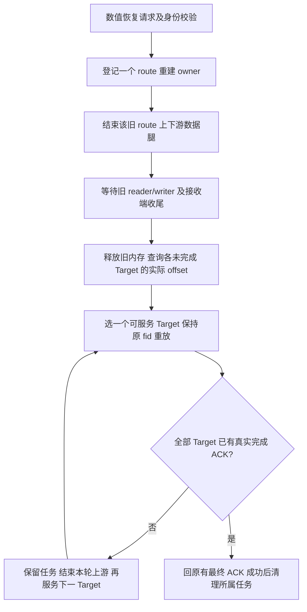

# 传输控制生命周期、全局转发暂停与顺序恢复 — 更改计划

状态：**用户已授权按最后拆分开始 C1；C1 实现及局部验收完成，等待人工审查；C2–C6 未开始**。保持原 upstream fid/child fid，不引入 leg_id，不修改 pause/start 和端口响应格式；本轮仅实施实际控制会话清理、旧 owner 收尾及旧 worker 固定 socket，不自动创建 git 提交、合并或推送。后续阶段仍逐项等待人工放行；本轮证据见[实施报告](transfer-control-lifecycle-report.md)。

需求依据：[需求卡](transfer-control-lifecycle-requirements.md)。历史实现依据：[上一轮计划](transfer-pause-start-direction-plan.md)及其报告；它们的历史验证结果不作为本轮验证结果。

## 1. 本轮范围与替代关系

### 1.1 保留的四组修改

1. **问题四/五**：按实际控制 socket 管理旧会话资源，删除按 peer 扫描进度表关闭当前 socket 的重复机制；旧 worker 不借用新控制连接。
2. **问题六**：Client 统一转发入口拒绝自身完整控制端点；同 host 不同端口仍可互传。
3. **问题七**：Source 是 route 的唯一用户控制仲裁者；任意端 pause/start 控制整个转发任务。暂停源端新增块，已有字节继续排空，数据 socket 不断开。
4. **问题八**：8A 验证恢复请求后结束旧 relay 的上下游数据腿，等待收尾并清掉旧内存，按各 Target 实际 offset 顺序重放；8B 保留所有 Target 已完成但上游 ACK 明确失败的 EOF 再确认。两者保持原 fid，分别实施和验收。

### 1.2 明确排除

- 撤回问题一“正常恢复流程已证明导致内容损坏”的结论；不以此另开修复。
- **问题二暂缓**：不为旧 pause/start 与同一控制会话、同 fid 数据腿重建的交叉窗口增加 leg_id、换新 fid 或其他代次隔离。控制发送失败沿用现有失败/关闭路径，允许人工重新操作或结束控制会话后恢复；不承诺该窗口自动无缝收敛。问题四/五的断线清理与其余恢复方案不因此取消。
- 问题三是已确认语义，不改为各端独立持有暂停锁。
- 问题九（超长文件名）、十（控制队列增长）、十一（无 owner 预置暂停）暂不处理。
- 不增加内存/磁盘回放缓存、不同 offset 的并行范围过滤、第二结果通道、ACK-of-ACK、能力协商或旧 wire 兼容分支。
- 不重构整个 TCP/加密/日志系统，不改 CI、依赖和覆盖率策略，不扩展 Web UI。
- 不承诺 NAT、控制端点变化后的身份迁移、跨进程同时写进度文件、同尺寸源文件内容变化或断电耐久性。

### 1.3 对旧契约的明确替代

- **保留**恢复时稳定 upstream fid/child fid、原接收路径、pause/start 及端口响应格式；不实现 leg_id、old/new fid 关联、恢复身份 rekey 或持久化迁移记录。
- **废弃**“Target 只暂停自己的 writer”；替换为 Source 仲裁全 route 停止新增源数据。
- **替换转发恢复**的 live upstream busy 静默跳过：有效恢复请求可触发该 route 的定向 teardown；重复请求只登记，不反复打断新重放。
- **普通传输**的 live/paused/negotiating/finalizing busy 静默跳过仍保留；暂停用 start，不因此扩大成任意普通传输强制重启。
- 用户 API 的 bool 仍表示登记/预留，不表示远端确认、恢复完成或文件成功。

## 2. 变更文件清单

| 类型 | 文件 | 关键内容 |
|---|---|---|
| 修改生产代码 | `PyFlow/network_api/connect_tcp.py` | 实际会话资源、固定 worker 控制 socket、relay 全局控制/恢复调度、自目标校验及完成清理；不改端口/控制帧字段 |
| 修改单测 | `test/unit/network_api/test_resume_matching.py` | 保留普通恢复 busy、稳定 fid/原路径/总长/offset 及收尾；覆盖恢复入口与会话生命周期交叉 |
| 修改单测 | `test/unit/network_api/test_transfer_handshakes.py` | 实际会话取消、listener/data owner 退役及旧 owner 排空；不增加代次字段 |
| 修改单测 | `test/unit/network_api/test_transfer_control.py` | Source 仲裁、全局状态转发、交叉意图和背压独立；不新增跨腿旧控制隔离保证 |
| 修改单测 | `test/unit/network_api/test_fid_routes.py` | 稳定 route/child、已完成集合、顺序调度、伪造请求不 teardown |
| 修改单测 | `test/unit/network_api/test_transfer_progress_query.py`、`test_delete_config.py` | 保持既有查询/快照 schema，关闭/删除与恢复占用 |
| 修改单测 | `test/unit/network_api/test_TCP_client.py`、`test_TCP_server.py` | 控制会话替换及资源生命周期必要回归 |
| 修改集成测试 | `test/integration/network_api/test_tcp_transfer_control.py` | 普通双端控制回归、全局暂停、旧清扫/旧 worker、强制恢复及自目标拒绝 |
| 修改集成测试 | `test/integration/network_api/test_tcp_transfer_resume.py` | 普通/转发同 fid 新数据腿、不同 offset 顺序恢复、部分完成、EOF/最终 ACK、重连和持久化 |
| 迁移受影响断言 | `test/integration/network_api/test_tcp_file_transfer.py`、`test_crypto_tcp.py`、`test_tcp_async_server.py`、`test/integration/test_forward_extension.py`、`test_forward_msg_attribution.py` | 只更新全局暂停、恢复和自目标语义触及的真实消费者；不做端口或 pause/start parser/helper 的协议迁移 |
| 修改使用文档 | `docs/source/File_Transfer/File_Transfer.rst`、`docs/source/Network_APIs/TCP_Server_APIs.rst`、`TCP_Client_APIs.rst` | API 结果、稳定 fid、全局暂停、offset 查询、恢复及暂缓边界 |
| 修改变更记录 | `docs/source/changes/transfer-fid-routes.md` | 保留稳定恢复 fid，取代独立 writer 暂停及 busy 恢复等旧契约；明确问题二暂缓 |
| 计划载体 | 本文件、`transfer-control-lifecycle-requirements.md`、旧计划的后续链接 | 本轮决策和审批状态，不改写历史通过记录 |
| 实施后新增报告 | `docs/plans/transfer-control-lifecycle-report.md` | 逐原子变更报告、路径证据、失败及未覆盖项；现在不创建完成报告 |

Web 的 `client_backend.py` 已知通过 Client 的文件/文件夹转发入口调用，不直接构造恢复消息；计划不修改该文件，统一入口必须覆盖 Web 调用。若实施发现额外真实消费者须修改，先更新文件清单，不扩大成 UI 功能。

当前 LSP 只有 Ruff，不支持 definition/references；本轮按现有声明和文本调用点定位。实施前重新检查导航能力；支持 references 时，改公开符号前必须查询引用，不声称 Ruff 已完成引用分析。

## 3. 接口与线上契约（拟定，随本计划确认）

### 3.1 保持不变的部分

- Server/Client 的 pause/start Python 签名不变；调用方仍传 fid/type/direction，不增加数据腿编号或代次参数。
- fid 始终标识原文件/route 的对应腿。`resume_trans(peer_addr, fid, offset)` 保留签名和 bool 登记语义，恢复后仍使用同一 fid。
- `/file`、`/file_folder`、`/forward_item ... fid=<fid> resume=<offset>` 保持现有形式；数值恢复请求保持五 token；文件数据头、文件块和最终 ACK 不增加字段。
- fid 分配和原进度/route/child 键不迁移，不新增恢复版本、old/new 映射或迁移日志。
- 公钥和独立传输不因此获得用户 pause/start 能力；端口解析结果、握手 port 结果、file_transfer_mode 签名及测试 helper 的端口返回值不因问题二而改变。

### 3.2 恢复请求与各目标 offset 收集

数值恢复请求保持五 token：

```text
/resume_trans <fid> <offset> <origin> <target>
```

为在强制关闭共享 relay 后取得各 Target 的**最终落盘**位置，扩展同一命令的查询形式，不增加新命令名：

```text
/resume_trans <child_fid> ? <origin> <target>
```

- `?` 仅为 Server 向该 route Target 发出的 offset 查询。Client 校验当前 Server 控制会话、target 为自身、download fid 与 origin 匹配，随后在后台等待该旧接收 owner 收尾/文件关闭，再用既有数值形式回复。
- Server 不用发送字节计数猜 Target 落盘进度；首次请求也可能早于其他在途字节落盘，teardown 后以查询回复为准。
- 查询只登记一次，回包不重复 teardown；离线/无保留接收记录的目标不虚构 offset，不阻塞可服务目标。未完成项保留，等待合法后续恢复/重连。
- 不增加定时重试循环，不让控制接收线程阻塞等待自己需要分派的消息。
- `parse_resume_command` 数值分支返回值不变；查询分支 tuple 的 offset 用 `None` 表示，`format_resume_line(..., offset=None, ...)` 生成 `?`。这是输入/输出值域扩展，全部消费者区分请求和查询。

### 3.3 保持控制/端口格式，明确暂缓边界

以下保持现有四 token 格式，不新增字段或确认轮次：

```text
/server_file_transfer_port <port> <fid> <stamp>
/pause_trans <fid> <type> <issuer_role>
/start_trans <fid> <type> <issuer_role>
```

- 继续校验实际控制 socket、fid/type/role 及当前 owner，不因转发路由而绕过现有控制入口。
- Server 跨腿转发请求或状态时，映射所属 route 的 upstream/child fid；Source 串行仲裁，Server 不成为第二决定者。
- 保留 pending/unresolved 握手隔离、同 fid 占用、ready 条件及旧 owner 排空。旧 owner 退役时释放所属控制状态和未发帧，旧 finally 仍按对象身份释放。
- **不承诺同一控制会话内，已发出的旧 pause/start 一定不能影响重建后的同 fid 数据腿。**这是本轮接受的问题二边界，不以新的分配器、消息字段或隐含重试机制替代。
- 控制命令的 True 仍只表示登记，不等于对端确认或断线后成功；失败沿用现有失败/关闭路径，可人工重新操作或结束控制会话后恢复。

## 4. 保留既有恢复记录与持久化模型

### 4.1 不做身份与持久化扩展

- 不实现 leg_id、old/new fid 迁移、恢复关联链、route rekey 或 `/file resume=<old_fid>:<offset>`。
- 不新增 `resume_from_fid`、数据腿代次参数或专门的身份迁移测试文件；不为暂缓的问题二迁移端口及控制消息消费者。
- 不新增快照根 version/rebinds，不为本轮扩展 route total，不改变五项进度值、scoped key、originator/targets/completed 结构。
- socket、owner、锁和用户暂停仍只存在运行时。重启读回仍用原 fid 和原路径，按原文件/端口握手重新建连。

### 4.2 同 fid 恢复的收尾与失败规则

1. 原拥有者真正退出并释放 active socket/发送占用/接收占用后，才能在同 fid 上建立新数据腿；检查与恢复预留在同一并发边界。
2. Receiver 从关闭后的原文件实际大小取 offset，按原 fid/peer/basename/total 校验继续使用原完整路径；不建立同名文件桥接或删除旧字节。
3. 握手中断时按原规则释放所属控制状态，保留允许恢复的文件/进度；不得绕过 pending/unresolved 握手或建立第二个数据 owner。
4. 新 owner 默认运行，不继承退役 owner 的用户暂停/请求/确认。无 owner 的预置暂停继续遵守既有规则，问题十一仍不在本轮。
5. 进程重启不恢复旧控制运行时状态；保留行继续从同 fid、原路径恢复，不增加数据腿计数或持久化版本。
6. 最终 ACK 明确失败保留原记录，成功只清理 owning 记录。ACK 写成功但对端应用是否收到的不确定窗口不以新增 ACK-of-ACK 解决。

普通恢复不因其他 fid 活跃而阻塞。tracking off 不凭空建立新可持久化文件行，但已有保留行仍可按原 fid 恢复；运行时控制和会话关闭不依赖进度开关。

## 5. 会话清理与全局暂停

### 5.1 会话清理（问题四/五）

- 复用 `_TransferHandshakeRegistry.track_socket/cancel_socket`，listener/data socket、握手和 worker 绑定实际控制会话；旧会话退出只取消自己的资源。
- 去掉两份 `_drop_stale_transfers` 及 peer-scoped 新连接 sweep。新会话需要等待的是事先捕获的旧 owner，而不是扫描时刚出现的当前 socket。
- 旧恢复闭包固定使用创建时的控制 socket；`_forward_one` 可由内部传入捕获的 control_socket，不能在旧 worker 内重新取得新 `self.client_socket`。
- 关闭资源、等待 worker 和持久化 I/O 不在全局锁或控制 reader 内执行；旧 finally 按 socket/entry/record 身份释放。
- route 强制重建是**另一个定向动作**：只关闭该 route 数据腿，不调用整个控制会话的 cancel_socket，不影响其他 fid。

### 5.2 全局用户控制（问题七）

- 普通传输保留当前 sender-authoritative 规则。
- 转发的 Target 请求/Server 本地操作先经实际控制会话、稳定 child/upstream、peer/type/role 和当前 owner 校验定位 route，再作为请求送到 Source 的同一 upstream fid。
- Source 的本地操作与这些请求在一个串行入口决定状态；Server 校验上游通知后，用各 Target 自己的 child fid 投影状态，不自行成为第二决定者。
- Server 下游控制记录是 Source 决定的投影；其暂停字段不能再阻塞 writer。移除 relay writer 的独立用户暂停门槛，继续排空既有字节；Source 下一块前才等待。
- 用户 start 不要求所有参与方逐个解锁。保留 confirmed/last_requested 以免未确认 pause→start 丢失，不把它改成请求 ACK 计数器。
- 自动背压请求与用户意图分开；高水位 reader 门槛仍独立，只有缓冲下降才能解除。记录实际峰值和一次扇出超调，不宣称 total RAM 的严格上限。
- 暂停不撤回最后一块，不阻止已完成文件的真实 ACK，也不把暂停计作传输失败。数据已全部发出时不凭暂停伪造完成；原有 ACK 成功条件不变，不另外设计新的全局超时策略。

## 6. 强制重建与逐 Target 调度（问题八）



- route 按原任务对象和稳定 fid 串行登记；重建期间到达的合法请求合并为待恢复目标，不反复 teardown。请求者仍有自己的活跃接收腿时继续按接收占用规则拒绝重复登记；不把 pause 当 resume。
- 强制关闭先停止旧读写，唤醒 pause/queue/pressure 等待，再释放内存。禁止边清旧队列边让旧 reader 入队，也禁止新流接到旧下游 socket。
- 每个未完成 Target 的 offset 从其旧文件关闭后的实际大小取得。按 FIFO 服务已经拿到合法 offset 且 Source/Target 在线的目标；每轮只建立一个上游和一个下游，保持原 fid 并使用既有数据握手。
- 一轮结束更新该 Target 完成集合。还有其他目标未完成时不向 Source 回整体成功 ACK；结束这一轮上游、保留 Source 上传和 Server route，旧发送 owner 收尾后再请求下一轮，不新增中间结果通道。
- Source 离线保留 pending，重连后继续；Target 离线不阻塞已可服务目标。每目标单轮失败保留恢复依据，不无间隔循环自动重试；后续合法请求/重连可再次触发。
- `offset=0` 是恢复而不是全新转发；空文件及 `offset==total` 走零正文，仍要求真实 ACK。
- 所有 Target 已完成、仅上游 ACK 明确失败时，允许原 Source/route 的 EOF 再确认：保持原 upstream fid，核对数据头总长和 offset，只回有完成记录支撑的最终 ACK，不重开 Target、不重发正文。
- 不新增 route total 字段。原 Source 从同 fid 保留上传行核对本地文件总长，Server 校验恢复头与 EOF offset，以及原 Source/route 的全 completed 证据；不能仅凭 offset==size 或未知 route 发送成功 ACK。

## 7. 数据流与所有路径验收映射

普通恢复：实际 Receiver → 原 fid/磁盘 offset → 同 fid 独占恢复预留 → 原文件命令和完整路径匹配 → 原端口握手建立新数据腿 → 实际内容/ACK → owning 清理。

转发控制：任意参与者 fid/type/role → Server 校验实际控制会话/peer/route/当前 owner → Source upstream 串行决定 → Server 按各 child fid 投影状态；文件循环只有 Source 停止新增块。

转发恢复：Target 请求 → route 校验/独占重建 → 旧数据腿退出及内存释放 → 逐目标 offset 回复 → 稳定 upstream/child、每轮重建数据连接 → 保留完成集合 → 所有真实 ACK 后终态清理。

| 路径 | 必须观察的证据 | 原子阶段/验证 |
|---|---|---|
| P01 普通上传恢复 | fid/原路径保持，实际 offset/内容/真实 ACK 正确 | C1；V1/V6，S1 |
| P02 普通下载恢复 | 同 P01，方向反转 | C1；V1/V6，S1 |
| P03 文件夹/同 basename 不同目录 | 原完整嵌套路径继续；不新建同名桥接文件 | C1/C3；V1/V3/V6，S1/S2 |
| P04 live/paused/握手/finalizing 普通对象 | 仍静默跳过，无第二 worker；保留未决握手隔离；其他 fid 独立 | C1；V1，S1 |
| P05 换腿期间再次断线/重启 | 原 fid/路径/进度仍可恢复；旧资源释放，不恢复旧运行时控制状态 | C1/C3；V1/V3，S1/S2 |
| P06 旧控制会话关闭/迟到 finally/延迟清理 | 只关闭旧资源；新 socket 保留；不依赖进度开关 | C1；V1，S1/S2 |
| P07 旧转发 worker 与 connect 交叉 | worker 不在新 socket 发握手，无 30s 等待环；旧占用退出 | C1；V1，S2 |
| P08 Source/Server/每个 Target 用户操作 | 同一 live route 的有限消息排空后确认值一致，只有 Source 决定；各端 start 可解除 | C2；V2，S3 |
| P09 交叉/重复/未确认 pause→start | 无换腿交叉时固定顺序证明不丢反向意图，无通知回包循环 | C2；V2，S3 |
| P10 暂停有在途/排队数据 | Source 下一块前等待；全部 Target 排空落盘；同 socket start；内容正确 | C2；V2，S3 |
| P11 背压和 start 交叉 | 本地 reader 硬门槛仍有效，内存不持续增长；不能放大成严格总内存上限声明 | C2；V2，S3 |
| P12 live/paused/EOF 上游收到合法转发恢复 | 旧上下游关闭、旧 worker 退出后内存清零；保持 fid；控制/其他 fid 不受影响 | C3；V3，S4 |
| P13 错 peer/origin/target/fid/重复恢复 | 非法无 teardown；合法重复只登记一个重建 owner，不中断新重放 | C3；V3，S4 |
| P14 多 Target 不同 offset/部分已完成 | 顺序重放各自字节；稳定 route/child 和完成集合不丢；完成目标不重传 | C3；V3，S4 |
| P15 Source/Target 离线和重连 | pending 保留、可服务目标继续、无忙重试；回连后同 fid 恢复 | C3；V3，S4 |
| P16 零 offset/空文件/EOF | 不新建全目标任务；不重发已收正文；必须真实 ACK | C1/C3/C4；V1/V3/V4，S1/S4/S5 |
| P17 所有目标完成、上游 ACK False/异常 | 保留可确认终态；同 fid EOF 补 ACK；不重开 Target；再次失败仍可确认 | C4；V4，S5 |
| P18 Client 自目标/混合目标/同机不同端口 | 自目标不建腿、不建行；混合只拒自身；其他合法目标内容/ACK 正确 | C5；V5，S6 |
| P19 tracking off/原保留行/query/delete/stop | 无凭空新进度；原 fid/query/快照 schema 不变；关闭后才能删 | C1/C3；V1/V3/V6，S1/S4 |
| P20 加密开关/rekey/线程式及 async/别名和 wildcard | 统一安全 I/O、不明文降级、不阻塞密钥接收；真实内容/ACK/owner 清理 | C1–C5；相应 V/S 的参数矩阵，V6 |

问题二不属于上述验收目标：删除此前专门要求同 fid 新旧 leg_id 隔离及错误 leg_id 校验的两项，现按 P01–P20 重新编号。保留原有测试，不为缩小本轮范围删除或跳过既有用例；不得把会话清理通过表述为跨腿旧控制问题已解决。

## 8. 原子拆分（固定次序，逐项人工审查）

预计行数包含必要回归和局部文档，不含本次计划文件；实际超过 500 行或混入独立意图必须先修订拆分，不在实现中自行扩大。每阶段完成一条可运行的行为路径及局部证据；不加占位分支、feature flag 或生产 no-op。

| 阶段 | 单一意图、必须修改点 | 文件与预计 diff | 局部验收 |
|---|---|---|---|
| C1 | 实际控制会话统一资源取消、旧 owner 收尾；删除 peer sweep；旧恢复固定 socket | connect_tcp；handshake/TCP lifecycle 与 control/resume 必要回归；250–450 行 | V1，S1/S2；P01–P07/P16/P19/P20 |
| C2 | 全局暂停，所有参与者请求交 Source 决定、Server 用各 child fid fanout；writer 排空，保留硬背压 | connect_tcp；transfer_control 单测及真实 control/转发用例；250–450 行 | V2，S3；P08–P11/P20 |
| C3 | 问题 8A：完整 route 定向 teardown/offset 查询/单 owner 调度，逐 Target 推进可服务请求；同 fid、无内存复用 | connect_tcp；fid_routes、control/resume 故障场景；300–500 行 | V3，S4；P03/P05/P12–P16/P19/P20 |
| C4 | 问题 8B：已完成 route 的上游 ACK 明确失败后，同 fid 做 EOF 再确认；不扩展 route schema | connect_tcp；既有 resume/control EOF 回归；180–300 行 | V4，S5；P16/P17/P20 |
| C5 | Client 统一入口拒绝自身目标，不误拒同机不同端口及其他目标 | connect_tcp；file_transfer/control 必要契约；60–150 行 | V5，S6；P18/P20 |
| C6 | 文档/变更记录/最终报告、规则沉淀、更新所有受影响契约描述；明确暂缓问题二 | 说明文档、变更记录、计划状态、实施报告；150–300 行 | V6；P01–P20 逐项列结论，不以通过数代替运行证据 |

顺序：`C1 → C2 → C3 → C4 → C5 → C6`。删除原 leg_id 分配/解析基础与端口/控制 wire 切换两个阶段，其余按原意图顺延编号。每项完成窄验证、运行证据和报告后等待人工放行；本计划确认不等于自动创建这些 git 提交。

## 9. 验收命令和证据格式（计划约定；实际执行见实施报告）

每个阶段完成代码/测试后运行一次本阶段窄验证，不在编辑中途反复跑检查。以下 `V` 是约定命令编号；既有稳定 fid、控制/端口字段保证保留，只更新全局暂停和恢复等已变更契约断言，不删路径、不降低内容/ACK/所有权保证。

```bash
# V1 — C1 会话生命周期
.venv/bin/python -m pytest test/unit/network_api/test_transfer_handshakes.py test/unit/network_api/test_TCP_client.py test/unit/network_api/test_TCP_server.py test/unit/network_api/test_resume_matching.py test/integration/network_api/test_tcp_transfer_control.py test/integration/network_api/test_tcp_transfer_resume.py -k 'disconnect or reconnect or session or owner or stale or cleanup or resume' -q
# V2 — C2 全局控制和背压
.venv/bin/python -m pytest test/unit/network_api/test_transfer_control.py test/integration/network_api/test_tcp_transfer_control.py -q
# V3 — C3 定向重建与顺序恢复
.venv/bin/python -m pytest test/unit/network_api/test_fid_routes.py test/integration/network_api/test_tcp_transfer_resume.py test/integration/network_api/test_tcp_transfer_control.py -k 'forward or relay' -q
# V4 — C4 EOF 与最终 ACK
.venv/bin/python -m pytest test/unit/network_api/test_resume_matching.py test/integration/network_api/test_tcp_transfer_resume.py -k 'ack or eof' -q
# V5 — C5 转发入口
.venv/bin/python -m pytest test/integration/network_api/test_tcp_file_transfer.py test/integration/test_forward_extension.py test/integration/test_forward_msg_attribution.py test/integration/network_api/test_tcp_transfer_control.py -k 'forward or relay or self_target' -q
# V6 — 最终一次受影响范围合并回归，不扩为项目全套
.venv/bin/python -m pytest test/unit/network_api test/integration/network_api/test_tcp_transfer_control.py test/integration/network_api/test_tcp_file_transfer.py test/integration/network_api/test_tcp_transfer_resume.py test/integration/network_api/test_crypto_tcp.py test/integration/network_api/test_tcp_async_server.py test/integration/test_forward_extension.py test/integration/test_forward_msg_attribution.py -q
```

实施阶段另建并在结束后删除一次性真实程序 `/tmp/pyflow-transfer-lifecycle-smoke.py`，不调用 pytest 测试函数、不 mock 文件/网络/加密主路径，固定 `--case` 入口：

- **S1** `--case direct-leg`：双向普通文件/目录、稳定 fid/原路径、旧会话 owner 清理、换腿中断/重启及 tracking off 原保留行；不加入同会话旧控制帧跨腿隔离保证。
- **S2** `--case relay-leg`：稳定 upstream/child、完成集合及旧 worker/旧控制会话交叉；证明旧任务不借新控制 socket。
- **S3** `--case global-pause`：至少两个 Target，逐一发请求，确认后 Source 不新增块、旧块排空、同 socket start、压力硬门槛。
- **S4** `--case serial-recovery`：不同落盘 offset、上游在线/暂停/EOF、多请求、离线目标及无关 fid；记录旧队列释放和每轮一个目标。
- **S5** `--case eof-confirm`：真实目标 ACK 后定向注入上游 ACK False/异常，再做同 fid 零正文确认，验证再次失败和重启。
- **S6** `--case self-target`：自身、混合目标和本机不同端口，保留合法目标传输结果。

每个 case 参数矩阵覆盖明文/加密，以及 thread/async 的对应实际分派；原端点重连覆盖配置别名、wildcard。用 Event/Barrier 固定顺序，计时只用于失败截止，不靠 sleep 碰运气。

证据每条包含：阶段/路径编号、实际命令与退出码、稳定 fid、实际控制/data socket owner、原路径和实际落盘 offset、完整内容比较/必要 hash、真正 ACK 结果、队列/worker/索引最终状态。快照沿用既有 schema，无新增身份迁移字段；问题二列“暂缓”，未运行参数组列“未覆盖”，不借历史结果充数。本节是批准前的验收约定，各阶段实际执行情况和失败记录见实施报告。

## 10. 影响、风险与人工确认闸门

- **公共契约/协议影响**：fid、原文件/转发命令、pause/start 及端口响应格式、端口解析/握手结果、file_transfer_mode 签名保持不变；不为问题二迁移消费者。全局暂停、强制转发恢复和 `/resume_trans ... ? ...` 查询仍改变契约；查询扩展 parser/formatter 的 offset 值域，必须同步所有消费者，不声称全部向后兼容。
- **持久化模型不变**：保留五项文件行、scoped key 和 relay schema；不新增版本、恢复绑定、route total 或数据腿编号。EOF 再确认依赖原 Source 上传行与真实 completed 记录，不把 offset 相等单独当成功证据。
- **并发风险**：不得持 progress/route/leg 全局锁等待 I/O 或线程；Source 旧 owner 退出前不得开下一轮；身份及 route 校验必须先于 teardown；同 fid 的旧 finally 不得清理新 owner。问题二的跨腿迟到控制窗口明确接受，不纳入自动收敛承诺。
- **完成语义**：已完成 Target 只保留证据，不重传；中间轮不得伪造整体成功；最后的 ACK 明确失败必须保留可确认状态。用户不接受的新结果通道和 ACK-of-ACK 不引入。
- **平台边界**：运行环境能验证的 Linux 结果不代替 native Windows；Windows/其他 Python 版本如未实际运行，报告明确未覆盖。不得通过改 CI 或阈值规避。
- **规则沉淀**：真实会话资源取消、不同 offset 顺序内容恢复、末次 ACK 再失败/成功三类消费者可见回归成为检查项，不新增源码字符串断言，也不为暂缓的问题二增加新测试约束。
- **文档/报告**：最终报告逐 P01–P20 给结论，单列问题二暂缓；每个原子变更含意图、范围、数据流、局部命令、未覆盖项、风险；文档随变更完成，不留“以后补”。

本轮用户已明确要求开始 C1，作为 C1 的实施授权；不再重复索取同一确认。C1 完成后提交局部证据与报告，等待人工审查，不因此自动进入 C2–C6。
